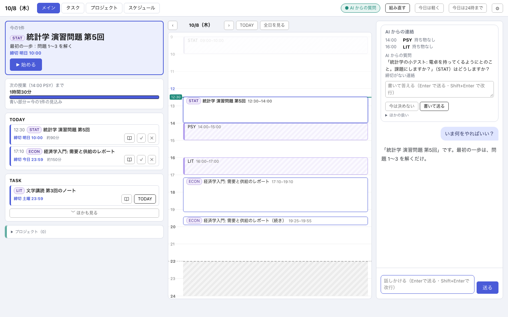
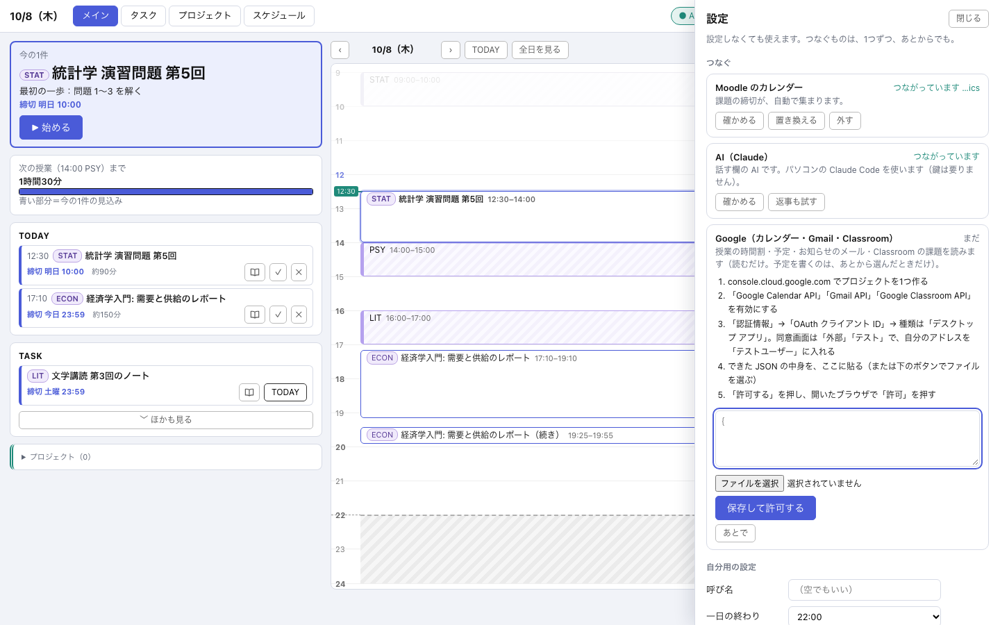
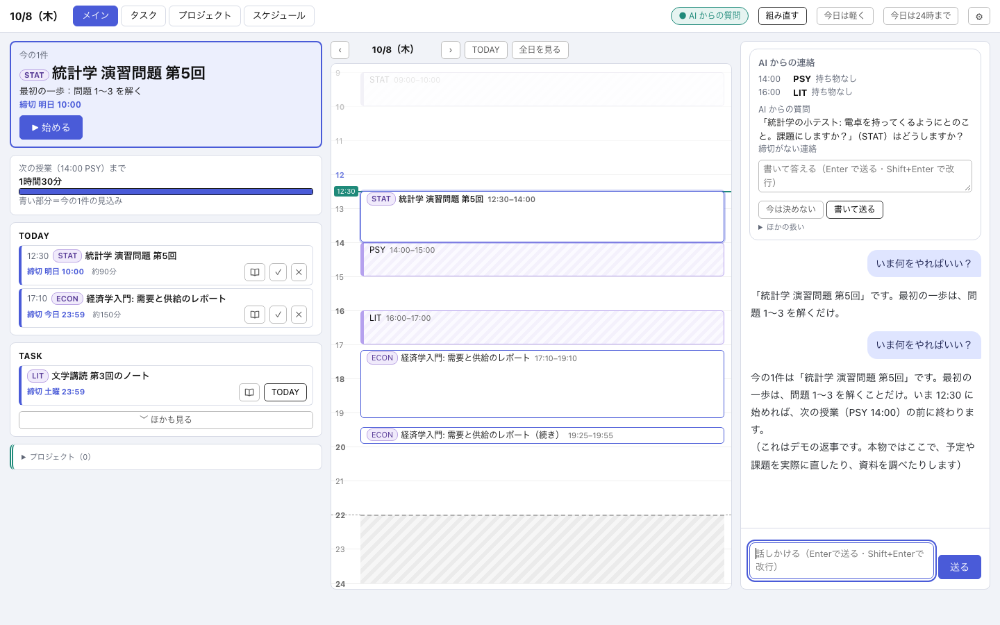
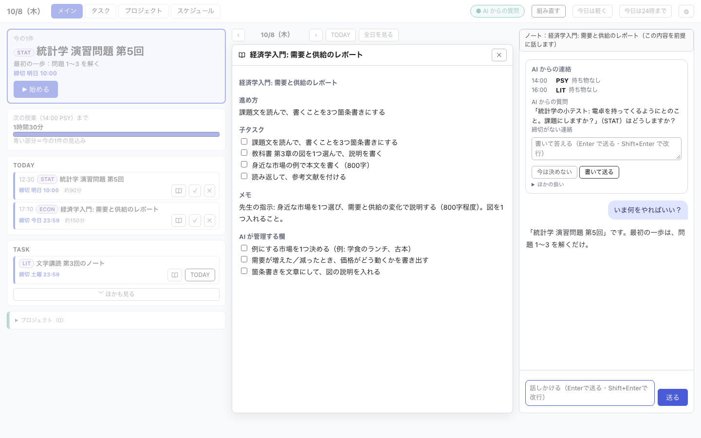

# PROJECT IGNITION

**「開始の瞬間だけを支援する」** 課題・予定アプリ。

課題を自動で集め、「**今これをやる**」の1件と**最初の一歩**だけを、いつも目に入る場所に出します。作業を管理するのではなく、「始められない」を越える一押しを作るための道具です。1人の学生が、自分のために作り、毎日使いながら直しています。



## 見てほしいところ

- **次の一手が、画面でいちばん大きい。** 情報は多くてよい（俯瞰したい）。でも、いまやることだけが一目で分かる。
- **罰を持たない。** 赤い警告・期限超過のバッジ・連続記録・点数を出さない。締切の事実は隠さず、責めない形で出す。
- **AI に頼める。** 話す欄で「これ、終わったよ」「明日の15時から友達と遊ぶ」のように言えば、意図を汲んで予定や課題を直す。直したことは必ず見えて、すぐ元に戻せる。AI が「やった」と言えるのは、実際に実行したあとだけ。
- **AI が、アプリ自身を直せる。** 別の場所で直し、全テスト・別の AI の審査・使う人の「適用」を通ったものだけが本番に入る。起動しなければ自動で戻る。
- **AI に全部は渡さない。** 小さな「今の状況」だけ渡し、残りは読み取り専用の道具で必要なときに引かせる。

## 自分用に設定する（使う人向け）

歯車（⚙）から開く「設定の部屋」で、**設定しなくても使い始められます**。つなぐものは、1つずつ・あとからでも。

- **つなぐ**: Moodle のカレンダー（URL を貼るだけ）／AI（パソコンの Claude Code を自動で見つける）／Google（カレンダー・Gmail・Classroom。自分で作ったデスクトップ用の ID の JSON を貼り、ブラウザで「許可」）。どれも「つないでみる」で**実際に読めるか**を確かめ、「12件の予定が見つかりました」のように結果を見せます。うまくいかないときは、原因を断定せず、直す1手を出します。
- **自分用の設定**: 呼び名・一日の終わり・今日の量の上限・AI の口調。再起動なしで効きます。「初期設定に戻す」「設定を書き出す」（鍵は入りません）。
- **鍵の扱い**: 鍵（URL・トークン）は `data/secrets/` にだけ（権限 600）。画面に再表示せず、末尾の数文字だけ。外すと取っておき、すぐ戻せます。内部のアドレスは受け付けません。



## デモを開く

画面だけを、架空のデータで動かせます（サーバーは要りません）。

```bash
cd ui
python3 -m http.server 8000
# → http://localhost:8000/ を開く
```

操作（始める・完了・予定を置く）は見た目の確認用で、データは変わりません。話す欄は決まった返事を返します。

| 話す欄・次の一手 | 課題のノート |
|---|---|
|  |  |

## 中身

- `src/` — 仕組みの部品（予定の組み立て・AI の指示の検査・安全な保存・AI による自己改造の関門など）。標準ライブラリだけで動く。自己改造の部品（`dev_agent` など）は、元のアプリの配置を前提にした**読むための部品**です。説明は [`ARCHITECTURE.md`](ARCHITECTURE.md)、部品の一覧は [`README_PARTS.md`](README_PARTS.md)。
- `ui/` — 画面（単一の HTML）と、デモ用の架空データ。
- `tests/` — 汎用部品のテスト。 `python3 -m unittest discover -s tests -q`

## 公開しているもの・していないもの

公開しているのは**仕組みと画面**です。作者の実データ・個人の言葉・学校専用の取り込み・鍵は含みません。書き出しのたびに、メールアドレス・名前・パス・科目名・鍵が残っていないかを機械で検査しています。画面の中の課題・授業・文章は、すべて架空です。

元のアプリは個人用で、非公開です。このリポジトリは、**見てもらい、意見をもらうため**に置いています。

## 意見がほしいこと

- 「次の一手が一目で分かる」は、本当に実現できているか。
- AI が意図を汲んで動く（言い方を問わず）ことと、勝手に変えない安全さの釣り合い。
- 他の人（始めることが苦手な人）が使うとき、何が足りないか。

Issue か、直接の連絡でお願いします。

## ライセンス

MIT
